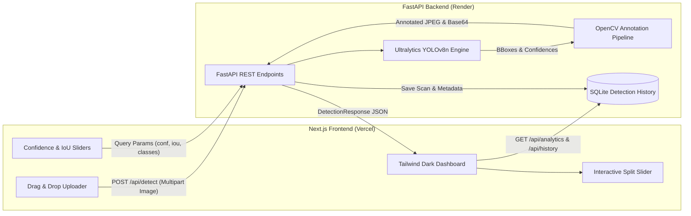

# AI Object Detection & Recognition System

[](https://www.python.org/)
[](https://fastapi.tiangolo.com/)
[](https://docs.ultralytics.com/)
[](https://nextjs.org/)
[](https://tailwindcss.com/)
[](https://sqlite.org/)
[](LICENSE)

A production-quality college project showcasing an end-to-end Computer Vision system for real-time object detection, bounding box localization, and visual intelligence. Powered by **Ultralytics YOLOv8 nano**, **OpenCV**, and **FastAPI** on the backend, paired with an interactive **Next.js (App Router)** and **Tailwind CSS** responsive dark UI designed for desktop and mobile devices.

---

## 🌟 Key Features

1. **Real Deep Learning Vision Pipeline (No Mockups)**:
   - Uses real **Ultralytics YOLOv8 nano (`yolov8n.pt`)** pretrained on COCO 80 categories (people, vehicles, animals, accessories, electronics, etc.).
   - Actual tensor inference running on CPU or GPU.
2. **Interactive Workbench & Dual Comparison Modes**:
   - **Interactive Split Slider**: Drag a horizontal slider to seamlessly compare the raw uploaded photo with the annotated detection output.
   - **Side-by-Side Mode**: Inspect high-resolution original and bounding-boxed views concurrently.
   - **Mobile Touch Support**: Responsive drag handle and touch gesture support on phones and tablets.
3. **Live Parameter Tuning**:
   - **Adjustable Confidence Threshold**: Range from 5% (high recall) to 95% (high precision).
   - **IoU / NMS Threshold**: Fine-tune bounding box suppression overlap.
   - **Category Multi-Filtering**: Isolate specific classes (e.g., detect only `person` and `car` in a crowded street).
4. **Rich Analytics & SQLite History**:
   - Every scan is automatically logged in asynchronous **SQLite** (`aiosqlite`).
   - Audit trail stores scan latency (ms), timestamp, object counts, and coordinates.
   - Real-time Analytics Dashboard computes total scans, total detected objects, average latency, and class frequency distribution bars.
5. **Multi-Format Export**:
   - **Annotated Image**: Download full-resolution JPEG with styled bounding boxes and confidence banners.
   - **CSV Scan Report**: Detailed spreadsheet listing coordinates, dimensions, confidences, and counts.
   - **JSON Machine Report**: Standard JSON payload for external pipeline ingestion.
6. **Deployment-Ready Separation**:
   - **Frontend**: Prepared for zero-config **Vercel** deployment with `vercel.json`.
   - **Backend**: Containerized with **Dockerfile** and blueprint `render.yaml` for **Render** web services.

---

## 🏗️ System Architecture



---

## 📁 Repository Structure

```
Object-Detection-System/
├── backend/                           # Python 3.12 FastAPI + YOLO Backend
│   ├── app/
│   │   ├── config.py                  # Pydantic environment settings
│   │   ├── database.py                # Asynchronous SQLite initialization
│   │   ├── main.py                    # FastAPI app, CORS, routes & static mounts
│   │   ├── models.py                  # Pydantic schemas (Detection, History, Analytics)
│   │   ├── routes/
│   │   │   ├── detection.py           # POST /api/detect & GET /api/classes
│   │   │   ├── history.py             # GET /api/history & DELETE endpoints
│   │   │   ├── analytics.py           # GET /api/analytics metrics
│   │   │   └── export.py              # Downloadable CSV & JSON reports
│   │   └── services/
│   │       ├── yolo_service.py        # YOLOv8 inference & OpenCV bounding boxes
│   │       ├── history_service.py     # SQLite persistence & query operations
│   │       └── report_service.py      # Automated CSV & JSON report builders
│   ├── tests/
│   │   ├── test_detection.py          # Unit tests for inference, upload & classes
│   │   └── test_history.py            # Tests for SQLite database CRUD & reports
│   ├── requirements.txt               # Locked Python dependencies
│   ├── Dockerfile                     # Docker container build for Render
│   ├── render.yaml                    # Render Web Service blueprint
│   ├── start.sh                       # Production entrypoint script
│   └── pytest.ini                     # Pytest configuration
│
├── frontend/                          # Next.js 14 + Tailwind CSS Frontend
│   ├── src/
│   │   ├── app/
│   │   │   ├── layout.tsx             # Root dark-mode layout
│   │   │   ├── page.tsx               # Detection Workbench dashboard
│   │   │   ├── analytics/page.tsx     # Historical audit trail & analytics view
│   │   │   └── globals.css            # Custom glow, scrollbars & Tailwind rules
│   │   ├── components/
│   │   │   ├── Navbar.tsx             # Top navigation & backend status badge
│   │   │   ├── Dropzone.tsx           # Drag & drop upload with 3 sample photos
│   │   │   ├── ControlsPanel.tsx      # Sliders for confidence, IoU & category filters
│   │   │   ├── ImageComparator.tsx    # Split slider & side-by-side visualizer
│   │   │   ├── DetectionResults.tsx   # Metric cards, class chips, itemized table
│   │   │   ├── ExportButtons.tsx      # Instant downloads (Image, CSV, JSON)
│   │   │   ├── HistoryTable.tsx       # SQLite history table with delete & export
│   │   │   └── AnalyticsCards.tsx     # Summary stat cards & frequency bars
│   │   └── lib/
│   │       ├── api.ts                 # Typed fetch client targeting FastAPI
│   │       └── types.ts               # Shared TypeScript data models
│   ├── package.json
│   ├── tsconfig.json
│   ├── tailwind.config.ts
│   └── vercel.json                    # Vercel deployment configuration
│
├── .gitignore
├── LICENSE
└── README.md
```

---

## 💻 Windows 11 Local Setup & Execution Guide

Follow these steps to run the complete system locally on Windows 11.

### Prerequisites
- **Git**
- **Node.js** (v18+ recommended; Node 24 verified)
- **Python 3.12**

### Step 1: Clone Repository
```powershell
git clone https://github.com/Rahulraj132613/Object-Detection-System.git
cd Object-Detection-System
```

### Step 2: Backend Setup (FastAPI & YOLOv8)
1. Open PowerShell and navigate to `backend/`:
   ```powershell
   cd backend
   ```
2. Create and activate a Python 3.12 virtual environment:
   ```powershell
   python -m venv .venv
   .\.venv\Scripts\Activate.ps1
   ```
3. Upgrade `pip` and install dependencies:
   ```powershell
   python -m pip install --upgrade pip
   pip install -r requirements.txt
   ```
4. Copy the environment configuration:
   ```powershell
   Copy-Item .env.example .env
   ```
5. Run the test suite to verify YOLO inference and SQLite:
   ```powershell
   pytest -v
   ```
6. Start the FastAPI development server:
   ```powershell
   uvicorn app.main:app --host 0.0.0.0 --port 8000 --reload
   ```
   *The backend will be available at `http://localhost:8000`. Swagger API docs at `http://localhost:8000/docs`.*

### Step 3: Frontend Setup (Next.js & Tailwind CSS)
1. In a new PowerShell terminal, navigate to `frontend/`:
   ```powershell
   cd frontend
   ```
2. Install npm packages:
   ```powershell
   npm install
   ```
3. Copy the environment configuration:
   ```powershell
   Copy-Item .env.example .env.local
   ```
4. Start the Next.js development server:
   ```powershell
   npm run dev
   ```
5. Open your browser and navigate to:
   ```
   http://localhost:3000
   ```

---

## 🌐 Production Deployment Guide

### A. Deploying Backend on Render
1. Create a free account on [Render](https://render.com).
2. Click **New +** > **Web Service** and connect your GitHub repository `Object-Detection-System`.
3. Set the following options:
   - **Root Directory**: `backend`
   - **Runtime**: `Python 3` or `Docker`
   - **Build Command**: `pip install -r requirements.txt && python -c "from ultralytics import YOLO; YOLO('yolov8n.pt')"`
   - **Start Command**: `uvicorn app.main:app --host 0.0.0.0 --port $PORT`
4. Set Environment Variables:
   - `PORT`: `8000`
   - `DEBUG`: `false`
   - `ALLOWED_ORIGINS`: `https://your-frontend.vercel.app,http://localhost:3000`
5. Click **Deploy**. Note down your Render backend URL (e.g. `https://ai-object-detection-backend.onrender.com`).

### B. Deploying Frontend on Vercel
1. Create a free account on [Vercel](https://vercel.com).
2. Click **Add New...** > **Project** and import `Object-Detection-System`.
3. In the configuration screen:
   - **Framework Preset**: `Next.js`
   - **Root Directory**: Click *Edit* and select `frontend`
4. Expand **Environment Variables** and add:
   - `NEXT_PUBLIC_API_URL` = `https://ai-object-detection-backend.onrender.com`
5. Click **Deploy**. Vercel will build and assign a production URL (e.g. `https://ai-object-detection-frontend.vercel.app`).
6. Test on any mobile browser or desktop.

---

## 🧪 API Documentation

The backend exposes an interactive OpenAPI Swagger UI at `http://localhost:8000/docs`:

| Method | Endpoint | Description |
| :--- | :--- | :--- |
| `GET` | `/api/health` | Health probe (service status & loaded model) |
| `GET` | `/api/classes` | Returns all 80 COCO categories recognized by YOLOv8 |
| `POST` | `/api/detect` | Uploads image, executes YOLO inference, returns bboxes & base64 image |
| `GET` | `/api/history` | Returns paginated list of past scans from SQLite |
| `GET` | `/api/history/{id}` | Fetches individual scan detail |
| `DELETE` | `/api/history/{id}` | Deletes individual scan record |
| `DELETE` | `/api/history` | Clears all history from SQLite |
| `GET` | `/api/analytics` | Computes aggregate scan counts, latency & top categories |
| `GET` | `/api/export/csv/{id}` | Downloads CSV summary of the scan |
| `GET` | `/api/export/json/{id}` | Downloads formatted JSON report |

---

## 📜 License
Distributed under the MIT License. See [LICENSE](LICENSE) for more information.
